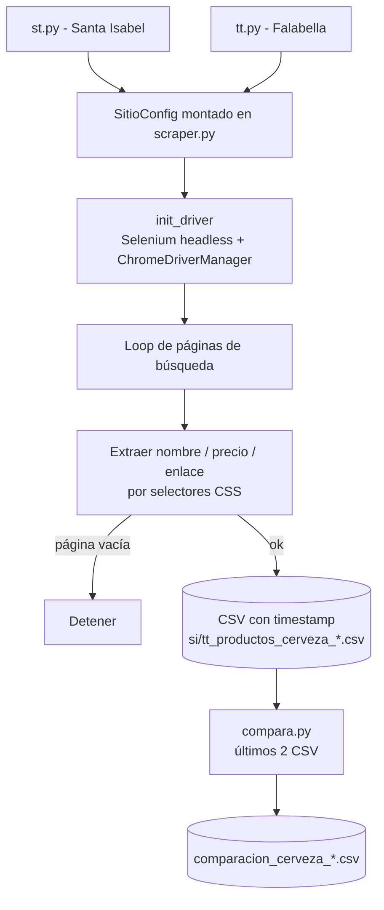

# MonsterScrapper

Herramienta de web scraping para e-commerce chilenos (Santa Isabel y Falabella). Extrae nombres de productos, precios y enlaces, los guarda en CSV y compara precios entre ejecuciones.

[](https://github.com/bi0punk/MonsterScrapper/actions/workflows/ci.yml)
[](https://www.python.org/)
[](LICENSE)

## Contenido

- [Características](#características)
- [Arquitectura](#arquitectura)
- [Stack](#stack)
- [Estructura del repositorio](#estructura-del-repositorio)
- [Instalación](#instalación)
- [Uso](#uso)
- [Tests / CI](#tests--ci)
- [Datos](#datos)
- [Roadmap](#roadmap)
- [Licencia](#licencia)

## Características

- Scraping del catálogo de cervezas en Santa Isabel y Falabella (Selenium headless).
- Configuración por sitio (URL base, selectores CSS, prefijo de CSV) parametrizada en `scraper.py`.
- Persistencia en CSV con timestamp por run.
- Comparación de precios entre los dos runs más recientes (`compara.py`): detecta subidas, bajadas y productos nuevos.
- `webdriver-manager` para auto-gestión de ChromeDriver.

## Arquitectura



Los dos entrypoints (`st.py`, `tt.py`) usan la lógica compartida de `scraper.py` (clase `SitioConfig` con `SANTASABEL` y `FALABELLA`).

## Stack

- **Lenguaje**: Python 3.12+.
- **Scraping**: Selenium (headless Chrome) + webdriver-manager.
- **HTTP**: requests.
- **Calidad**: ruff (lint), pytest.

## Estructura del repositorio

```
MonsterScrapper/
├── st.py                # Scrapea Santa Isabel (productos cerveza)
├── tt.py                # Scrapea Falabella (productos cerveza)
├── scraper.py           # Lógica compartida parametrizada
├── compara.py           # Compara los dos CSV dumps más recientes
├── requirements.txt
├── pyproject.toml       # config pytest + ruff
├── tests/test_smoke.py
├── .github/workflows/ci.yml
└── LICENSE
```

## Instalación

Requisitos: Python 3.12+ y Google Chrome o Chromium instalado (Selenium usa el binario del sistema).

```bash
python3 -m venv .venv
source .venv/bin/activate
pip install -r requirements.txt
```

## Uso

```bash
python st.py        # scraping Santa Isabel → CSV
python tt.py        # scraping Falabella → CSV
python compara.py   # compara los dos CSVs más recientes
```

Los CSV se nombran `si_productos_cerveza_<timestamp>.csv` (Santa Isabel) y
`tt_productos_cerveza_<timestamp>.csv` (Falabella) en el directorio actual. La comparación genera `comparacion_cerveza_<timestamp>.csv`.

## Tests / CI

```bash
pytest -q
```

Smoke tests (`tests/test_smoke.py`): imports de los scripts (sin ejecutar scraping real), helper `obtener_ultimos_csv` de `compara.py` (directorio vacío → lista vacía), deps listadas.

CI — GitHub Actions (`.github/workflows/ci.yml`) sobre Python 3.12, disparado en push/PR a `main`/`master`:

- **lint** — `ruff check .`.
- **test** — `pytest -q` (no requiere Chrome; los scripts no arrancan el driver al importarse gracias al guard `__main__`).

## Datos

- CSVs `productos_cerveza_*.csv` generados por los scripts (gitignored, se regeneran).
- Sin base de datos; la comparación se hace sobre los CSVs del directorio.

## Roadmap

- [x] Scraping de Santa Isabel y Falabella con lógica compartida.
- [x] Comparación de precios entre runs.
- [ ] Base de datos histórica persistente (actualmente solo CSVs sueltos).

Limitaciones: depende de la estructura HTML de los sitios (los cambios pueden romper los selectores CSS) y requiere Chrome/Chromium instalado para Selenium.

## Licencia

GPL-3.0 — ver [LICENSE](LICENSE).